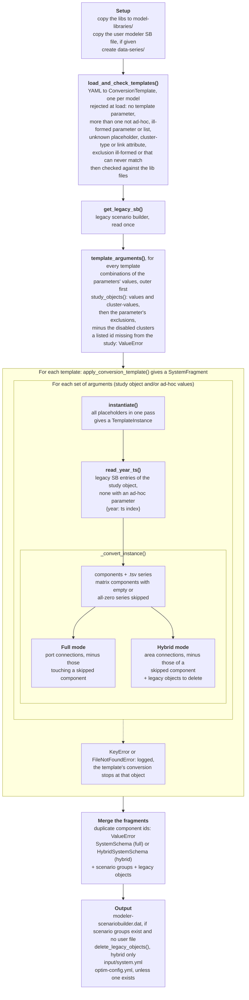

# AGENTS.md

This file provides guidance to AI coding agents (LLMs, copilots, code assistants) when working with this repository. It is tool-agnostic and should be read by any AI agent before making changes.

---

## Project Overview

**AntaresLegacyModels-to-GEMS-Converter** converts [Antares Simulator](https://antares-simulator.readthedocs.io/) legacy studies into the [GEMS](https://gems-energy.readthedocs.io/) format. It takes mathematical models that were historically embedded in the Antares solver code (thermal clusters, links, short-term storage, batteries, renewables, load/solar/wind, hydro, misc gen) and produces explicit GEMS YAML system files and timeseries data.

Repository: `AntaresSimulatorTeam/AntaresLegacyModels-to-GEMS-Converter` — License: MPL 2.0

---

## Directory Layout

```
src/antares_gems_converter/
  input_converter/
    src/
      main.py                  # Command line interface entry point 
      converter.py             # AntaresStudyConverter orchestrator:
- Reads an Antares study (full or hybrid mode)
- `apply_conversion_template()` applies one template to the study and returns a `SystemFragment` (see "Template loop")
- `load_and_check_templates()` loads the templates of `models_to_convert` and checks them against the lib files
- `system_and_scenario_groups(templates)` converts the templates and returns the GEMS system with its scenario groups; it writes no output file other than the data series
- Full: also converts areas themselves into GEMS components
- `process_all()` copies the libraries, writes modeler-scenariobuilder.dat, deletes the converted legacy objects (hybrid), dumps output/input/system.yml and writes optim-config.yml

      templates.py - loads the YAML templates; `StudyObject` (a link, area or cluster, with its placeholder substitutions); `study_objects()` returns the objects a template parameter yields, restricted to its lists, skipping those it excludes (`is_excluded()`) and the disabled clusters; `template_arguments()` returns what a template is instantiated for (`TemplateArguments`: one combination of the values of its parameters, for each instance)
      checks.py - checks the templates against the provided lib files (model ids, and parameter/property ids in both directions)
      scenario_builder.py - reads the legacy scenario builder (`read_year_ts()` per `StudyObject`, from which the converter sets the components' scenario groups), clears the legacy entries of deleted objects, copies or writes modeler-scenariobuilder.dat
      deletion.py - hybrid mode: deletes (or blanks) the converted Antares objects from the study copy in-place
      optim_config.py - writes the default optim-config.yml unless one exists


      parsing.py - Pydantic models for YAML conversion templates
- ConversionTemplate / TemplateInstance / ObjectKind - see "Template loop"; templates are validated at load
- ParameterConversionConfig - parameter source: constant (float), matrix column, or object + optional operation
- PropertyConversionConfig - property source (similar to ParameterConversionConfig; result always converted to string)
- Operation - max / multiply_by / divide_by on a value or timeseries
- parse_conversion_template() - YAML file → ConversionTemplate
- parse_library() - GEMS library YAML file → LibrarySchema (raises ValueError naming the file)
      config.py  - lookup dictionaries used by the converter

-   `TEMPLATE_CLUSTER_TYPE_TO_GET/DELETE_METHOD` - maps thermal/renewable/st_storage → antares-craft area methods
- `STUDY_LEVEL_GET/DELETION` - maps `area/link/binding_constraint` → study-level methods
- `MATRIX_TYPES_TO_GET/SET_METHOD` - maps `load/solar/wind/misc_gen` → timeseries get/set methods
- `HYDRO_TYPE_TO_SET_METHOD` - maps hydro field names → antares-craft hydro setter methods
- `BLANKED_LEGACY_OBJECT_TYPES` - legacy object types that hybrid mode blanks instead of deleting; GEMS components replacing them get the `_gems` suffix
- `TIMESERIES_NAME_TO_METHOD` - maps template timeseries keys → antares-craft getter methods
- `MODEL_NAME_TO_FILE_NAME` - maps model names → their YAML template filenames
- `MATRIX_TYPES` - templates whose components are skipped when their time series are empty or all zeros
      utils.py - small I/O helpers
- `resolve_path` - resolves a `Path` to absolute, raises if it doesn't exist
- `check_file_exists` - returns `True` only if file exists and is non-empty
- `check_dataframe_validity` - returns `False` if DataFrame is empty or all-zeros
- `dump_to_yaml` - serializes a Pydantic model into `system.yml` (`mode="json"` + `yaml.safe_dump`: plain YAML only, unset and `None` fields omitted)
- `save_to_file` - writes a DataFrame/Series to a tab-separated file, creating dirs as needed

      logger.py - loger factory 
- Logger(name, file_name) - creates a logging.Logger that writes to both stdout and an optional .log file at INFO/DEBUG level with timestamp + module + line format

      data_preprocessing/
        preprocessing.py - `ModelConversionPreprocessor`: extracts raw data from the study and converts it to GEMS parameter values

- `convert_param_value(id, value_content, component_id)` - entry point: returns a constant directly, or delegates to `calculate_value()`
- `calculate_value(obj, component_id)` - dispatches by object type: area, matrix (load/wind/solar/misc_gen), binding constraint, link, cluster, or hydro; builds the output `.tsv` path as `{param_id}_{component_id}.tsv`
- Each `calculate_*` method fetches the relevant timeseries/scalar from antares-craft and optionally applies an `Operation`
- Timeseries are saved to `output/input/data-series/` as `.tsv`, scalars are returned directly
- `check_timeseries_validity()` - checks a matrix is non-empty and non-zero before emitting a component

        data_classes.py        # ConversionMode enum (FULL, HYBRID)
    data/
      config.ini               # Default INI config template
      model_configuration/     # YAML conversion templates (one per model type)
  libs/
    antares_historic/
      antares_legacy_models.yml   # GEMS model definitions for Antares legacy components
    reference_models/
      andromede_v1_models.yml     # Andromede reference models (battery, DSR, etc.)
  catalogs/                       # GEMS-ViewsBuilder metric catalogs
  taxonomies/                     # Taxonomy + flattened copy (temporary, no parent categories)
  views_config/                   # GEMS-ViewsBuilder view templates (extra-locations, aggregations-patterns filled per study; metrics lists every metric of the template's catalog, as <catalog_id>.<metric_id>, to trim per study)
  antares_runner/
    antares_runner.py             # AntaresHybridRunner, benchmarker, modeler runner
tests/
  input_converter/               # Unit/integration tests (in-memory studies via antares-craft)
  antares_historic/              # E2E tests (require Antares Simulator binary)
.github/workflows/ci.yml        # CI pipeline
.github/workflows/check-views-builder-update.yml  # Weekly check: opens an issue on new GEMS-ViewsBuilder release
pyproject.toml                   # Package metadata, tool config (Black, isort, mypy)
dependencies.json                # Antares Simulator version for CI
```

---

## Conversion Pipeline

### Overview

1. **CLI** (`main.py`) reads an INI config specifying study path, output folder, library paths, and conversion mode.
2. **AntaresStudyConverter** (`converter.py`) loads the Antares study via `antares-craft`, loads YAML conversion templates, and iterates through each model type.
3. **Template loop** (`templates.py`, `parsing.py`): each template is instantiated for each combination of the values of its parameters (links, areas, clusters, or ad-hoc values), its `${area}`, `${thermal}`, `${link}`, etc. placeholders replaced with these values (see below).
4. **Data extraction** (`preprocessing.py`) reads timeseries and scalar parameters from the study, writes timeseries to TSV files in `data-series/`.
5. **Output**: a GEMS `InputSystem` dumped to `input/system.yml`, with libraries copied to `model-libraries/` and timeseries in `data-series/`.

### Workflow of `process_all()`

The nested part is the template loop (see below).



`get_legacy_sb()`, `template_arguments()`, the template loop and the merge run in `system_and_scenario_groups()`, which `process_all()` calls with the templates from `load_and_check_templates()`.

### Template loop

| Term | Class | Meaning |
|---|---|---|
| template | `ConversionTemplate` | the YAML file, with placeholders; shares its body (`TemplateBody`: model, components, connections, legacy objects to delete) with its instances |
| template parameter | `TemplateParameter` | yields a list of string values: study objects, or the `values` of an ad-hoc parameter |
| object kind | `ObjectKind` | the type of the study objects a parameter yields: `ConversionTemplate.for_each` |
| study object | `StudyObject` | one link, area or cluster of the study; knows its placeholder substitutions |
| arguments | `TemplateArguments` | one combination of the values of the parameters: its substitutions, and its study object if any |
| instance | `TemplateInstance` | the template instantiated for one set of arguments, no placeholder left |
| fragment | `SystemFragment` | the GEMS output of one or more instances |

User-facing examples of `values`, `cluster-values`, `exclude` and ad-hoc parameters: [docs/template-parameters.md](docs/template-parameters.md); keep it in sync with this section.

`system_and_scenario_groups()` first computes the arguments of every template (`template_arguments(template, …)`), so that an id listed in a template but missing from the study fails before anything is converted. `apply_conversion_template()` then instantiates the template for each set of arguments (`template.instantiate(arguments.substitutions)`), reads its legacy SB entries (`read_year_ts()`) and converts the instance (`_convert_instance()`). Duplicate component ids in the output system raise a `ValueError`.

- **Parameters** are nested in declaration order (outer first), in any order. At most one parameter has no `ad-hoc` flag: it yields study objects, and `for_each` is derived from it: `name: link` → links (`${link}`, `${link}.area_from_id`, `${link}.area_to_id`); `name: area` with `cluster-type: <type>` → the clusters of that type in each area (`${area}` and `${<type>}`, e.g. `${thermal}`); `name: area` alone → areas (`${area}`). The others are ad-hoc (`ad-hoc: true`, `${<name>}`). `for_each` is `None` when every parameter is ad-hoc. Validators reject any other shape at load (`_check_parameter`).
- **Lists** (inline, non-empty, without duplicates): `values` restricts the areas or links (antares-craft ids, e.g. `at / fr`) and `cluster-values` the clusters of the `cluster-type` in each area (`${area}` in its entries stands for the area of the cluster); on an ad-hoc parameter, `values` is the iteration. Entries are strings: quote numbers in YAML (`values: ["2030"]`). The entries may use the placeholders of the outer parameters (checked at load, link attributes included). Without a list, every study object. A listed area or link missing from the study, or a listed cluster in none of the listed areas (before `exclude`), raises a `ValueError` naming the template, the parameter and the ids.
- **Ad-hoc parameters**: a non-empty `values` list is required; `cluster-type`, `cluster-values` and `exclude` are not allowed; the name is an ASCII `\w+` identifier (`json.dumps` escapes other characters, so a non-ASCII placeholder would never be substituted) other than an `ObjectKind`; its placeholder must be used in the body or in the lists of the inner parameters, otherwise every value would give the same components. A template with an ad-hoc parameter cannot have `legacy-objects-to-delete` (its components replace no legacy object), and gets no legacy SB lookup, hence no scenario group. Its ids are the template author's responsibility: they must not reuse the id of a legacy object still in the study.
- **Substitution** (every placeholder of the body must be one of the parameters', checked at load) replaces the placeholders in every string of the template (values, not keys), and in the lists and exclusions of the inner parameters, in one pass, the longest placeholder first; a placeholder left raises a `ValueError`.
- **`exclude`** (under the parameter that yields study objects): the objects this template is not instantiated for, applied after the lists; it applies to this template only. An entry sets `type` (an `ObjectKind`) and only `area`, `link`, or `area` and `cluster` for a cluster type; any other entry is rejected at load. An excluded area also excludes its clusters and the links it is an end of; in a cluster exclusion, `${area}` stands for the area of the cluster. An entry must be able to match an object the parameter yields, so its `type` is `area` or the template's `for_each`:

  | parameter yields (`for_each`) | `type: area` | `type: link` | `type: <cluster type>` |
  |---|---|---|---|
  | areas | that area | rejected | rejected |
  | links | the links it is an end of | that link | rejected |
  | clusters of a type | its clusters of that type | rejected | that cluster, if of the template's type, else rejected |

  An entry may use the placeholders of the outer parameters and, in a cluster exclusion only, `${area}` (`{type: area, area: ${area}}` or `link: ${area} / z_batteries` would match nothing). Any other entry is rejected at load. Filling it is the user's responsibility: the reference templates only exclude what they cannot convert themselves (battery excludes the `z_batteries` areas). To keep e.g. the battery legacy artefacts from being converted by the area, thermal or link templates as well, the user declares them in the `exclude` of those templates (see `exclude_battery_artefacts` in `tests/input_converter/conftest.py`); in hybrid mode, excluded objects are not converted, hence not deleted, and stay legacy.
- **`exclude` and `legacy-objects-to-delete` are distinct**: the former decides which objects are iterated over (both modes); the latter lists what hybrid mode removes from the study copy after the conversion.

### Two Conversion Modes

- **FULL** — generates a standalone GEMS study from scratch. Components are connected via port-to-port connections. The `area` model is required and is added automatically to `models_to_convert` if absent (with a warning).
- **HYBRID** — copies the original Antares study, replaces selected components with GEMS equivalents using area-connections, and deletes the replaced legacy objects from the copy. Antares >= 10.2 gives legacy objects the same ids as the templates (e.g. `<area>_thermal_<cluster>`, `<area>_load`) and rejects GEMS components that reuse the id of a legacy object still in the study. Replaced clusters and links are deleted, so their GEMS components keep the template id. When antares-craft refuses a deletion because a binding constraint references the object, the conversion fails with a `ValueError`: the legacy object would be counted twice, and Antares would reject the GEMS id. Area-level objects (load, wind, solar, misc gen, hydro, ror) cannot be deleted, only blanked: the GEMS components that replace them get the `_gems` suffix (`HYBRID_COMPONENT_ID_SUFFIX`, e.g. `fr_load_gems`). The converter adds it, not the templates, for every template whose `legacy-objects-to-delete` has a type in `BLANKED_LEGACY_OBJECT_TYPES` (`config.py`). The `area` model is incompatible with this mode and is removed automatically from `models_to_convert` if present (with a warning).

### Config Registry (`config.py`)

This module is a central lookup table that maps component types to `antares-craft` API methods. All dictionaries (`TEMPLATE_CLUSTER_TYPE_TO_GET_METHOD`, `MATRIX_TYPES_TO_SET_METHOD`, `TIMESERIES_NAME_TO_METHOD`, `MODEL_NAME_TO_FILE_NAME`, etc.) are authoritative — adding a new model type requires entries here.

---

## YAML Conversion Templates

Templates in `input_converter/data/model_configuration/` define how each Antares component type maps to a GEMS model. Every template follows this structure:

```yaml
template:
  name: <model-name>                    # e.g., thermal, link, battery
  model: <library_id>.<model_id>        # GEMS model reference
  template-parameters:                  # nested in declaration order (see "Template loop")
    - name: <variable>                  # area or link, unless ad-hoc
      values: [<id>, ...]               # optional: only these areas or links
      cluster-type: <type>              # optional: thermal, renewable, st_storage
      cluster-values: [<id>, ...]       # optional: only these clusters (${area} allowed)
      exclude:                          # optional: objects this template is not instantiated for (see "Template loop")
        - id: <identifier>
          object-properties: { type: ..., area: ... }
    - name: <variable>                  # optional: an ad-hoc parameter, ${<variable>}
      ad-hoc: true
      values: [<value>, ...]            # required: the values iterated

  components:
    - id: <id-with-${variable}-placeholders>
      parameters:
        - id: <param_id>
          time-dependent: true|false
          scenario-dependent: true|false
          value:
            constant: <number>            # OR object-properties reference below
            object-properties:
              type: area|thermal|link|load|solar|wind|st_storage|binding_constraint|hydro|misc_gen
              area: ${area}
              cluster: ${thermal}         # for cluster types
              field: <antares_craft_field>
            column: <int>                 # optional: extract specific column from matrix
            operation:                    # optional: transform after extraction
              type: max                   # OR multiply_by: <value> OR divide_by: <param_ref>
      properties:                         # optional: component properties (string values)
        - id: <property_id>
          value:
            constant: <number|string>     # OR object-properties reference (same syntax as parameters); supports template variables (e.g. ${thermal})
            object-properties:
              type: area|thermal|link|...
              area: ${area}
              cluster: ${thermal}
              field: <antares_craft_field> # scalar field; result is converted to string

  connections: [...]          # FULL mode: port-to-port
  area-connections: [...]     # HYBRID mode: port-to-area
  legacy-objects-to-delete: [...]  # HYBRID mode: objects to remove from copied study
```

### Key template conventions

- **Placeholder syntax**: `${area}`, `${thermal}`, `${link}`, `${<ad-hoc parameter>}`, etc. — replaced for each set of arguments the template is instantiated for.
- **Link attribute access**: `${link}.area_from_id`, `${link}.area_to_id` are replaced by the link's areas; a following `.` is dropped (`${link}.area_from_id._node` → `at_node`). No other link attribute is allowed.
- **Binding constraint fields**: use `%` and `.` separators (e.g., `${area}%z_batteries`, `${area}.${area}_batteries_inj`).
- **Column indexing**: 0-based, references actual columns in Antares data matrices.
- **Operations**: `divide_by` can reference another parameter by name (e.g., `divide_by: reservoir_capacity`).
- **Electricity carrier assumption**: all current templates assume components belong to the electricity system (`carrier: electricity`). Multi-energy support would require revisiting this assumption in every template.
- **Identifier naming** (components, parameters, properties): `snake_case`; qualifier first (adjective before noun); `is_` prefix for booleans; units in schema metadata, not names. Component IDs start with the area: `${area}_<detail>` (e.g. `${area}_node`, `${area}_hydro_storage`) — never `<detail>_${area}`. Abbreviations whitelist: `gen` (generation), `prop` (proportional), `abs` (absolute), `alg` (algebraic), `min` (minimum), `max` (maximum), `num` (number), pollutant codes (`co2`, `nh3`, `so2`, `nox`, `pm2_5`, `pm5`, `pm10`, `nmvoc`, `op1`–`op5`). Everything else spelled out in full.

---

## GEMS Model Libraries

- **`antares_legacy_models.yml`** — Defines models for: `area`, `load`, `link`, `renewable`, `thermal`, `short_term_storage`, `miscellaneous_generation`, `long_term_storage`. These mirror the implicit models in the Antares solver.
- **`andromede_v1_models.yml`** — Defines models for: `battery`, `dsr`, `electrolyser`. These represent new modelling constructs not in the legacy solver.

Both use the `flow` port-type with a single `flow` field for power balance connections.

---

## Running Tests

### Prerequisites

- Python >= 3.11 (CI uses 3.12)
- E2E tests in `tests/antares_historic/` require the Antares Simulator binary (version defined in `dependencies.json`). CI downloads it automatically.

### Commands

```bash
uv sync --group dev

# Run all tests
uv run pytest

# Run tests in parallel (pytest-xdist)
uv run pytest -n auto

# Prefer parallel for unit/integration tests
uv run pytest tests/input_converter/ -n auto

# Run a specific test
uv run pytest tests/input_converter/test_converter.py::TestConverter::test_convert_thermals_to_component

# Run one test file
uv run pytest tests/antares_historic/test_thermal_model.py

# Type checking
uv run mypy src/

# Formatting check
uv run black --check --diff src/

# Coverage
uv run pytest --cov=antares_gems_converter --cov=antares_runner --cov-report=html
```

### Test Architecture

| Directory | What it tests | Dependencies |
|-----------|---------------|--------------|
| `tests/input_converter/` | Converter logic: template loop, YAML output, component generation | `antares-craft` in-memory studies (no binary needed) |
| `tests/antares_historic/` | Converted models produce correct optimization results; catalogs, taxonomies and view configs work with GEMS-ViewsBuilder | Antares Simulator binary, `gems-views-builder` |

**Fixture pattern** (`tests/input_converter/conftest.py`): Fixtures build up progressively — `local_study` → `local_study_w_areas` → `local_study_w_thermal` etc. Each adds one layer of study objects. Tests use these to create `AntaresStudyConverter` instances.

**E2E test pattern** (`tests/antares_historic/`): Create an Antares study programmatically, convert it to GEMS format, run both original and converted through the solver, compare objective values with `pytest.approx()`.

---

## CI Pipeline (`.github/workflows/ci.yml`)

Runs on every push to any branch:

1. Install deps (`uv sync --group dev`)
2. Type checking: `mypy src/`
3. Format checking: `black --check --diff` (Black 23.7.x)
4. Download and extract Antares Simulator binary (version from `dependencies.json`)
5. Run tests
6. Upload test failure artifacts on failure (logs)

---

## Git & Branching Model

- **`main`** — stable releases
- Feature branches from `main`, PRs back to `main`
- No direct pushes to `main`
- CI runs on every push

> **Full ecosystem developer guide:** the authoritative branching, versioning, CI/CD, and release process for all repositories (including this converter) lives in the GEMS Developer Guidelines, published at <https://gems-energy.readthedocs.io/en/latest/support/dev-guidelines/>. Fetch this page (e.g. via WebFetch) before any branching, versioning, or release work.

---

## Coding Conventions

### Python

- Type hints required; `pathlib.Path` for file paths
- Pydantic `BaseModel` for data structures (with `_to_kebab` alias generator for YAML key mapping)
- Logging via `logging.getLogger(__name__)` — no bare `print()`
- Black formatter (line-length 88), isort with Black profile
- mypy enforced on `src/` only (`ignore_missing_imports = true`)
- `pythonpath = src` in `pytest.ini` — imports use `antares_gems_converter.*`

### YAML

- Conversion template files use kebab-case keys: `template-parameters`, `cluster-type`, `object-properties`
- Library model IDs: lowercase with underscores or hyphens
- Indentation: 2 spaces

---

## Critical Rules for AI Agents

1. **Template ↔ model parameter and property ids must match, both ways.** Each component of a conversion template declares exactly the parameters and properties of the referenced GEMS model: no unknown id, none missing. `check_converted_models_are_in_libs` (`checks.py`) checks this for the templates in `models_to_convert` and raises a `ValueError` naming the template, component, model and ids. `test_templates_match_library_models` runs it on all templates.

2. **`config.py` is the single source of truth for mappings.** Adding a new model type requires entries in `MODEL_NAME_TO_FILE_NAME`, and possibly `TEMPLATE_CLUSTER_TYPE_TO_GET_METHOD`, `TIMESERIES_NAME_TO_METHOD`, and other mapping dictionaries. Missing entries cause `KeyError` at runtime.

3. **Library YAML files are shared across studies.** `libs/antares_historic/antares_legacy_models.yml` and `libs/reference_models/andromede_v1_models.yml` are referenced by all conversion templates. Edits to model parameters, port definitions, or constraints affect every conversion.

4. **FULL vs HYBRID mode produce different outputs.** FULL mode uses `connections` (port-to-port). HYBRID mode uses `area-connections` and `legacy-objects-to-delete`. Both sections must be kept consistent in templates.

5. **Exclusions are local to their template** (see "Template loop"). Do not add study-specific exclusions to the reference templates.

6. **Timeseries validity check.** `check_timeseries_validity()` rejects empty or all-zero dataframes. If a load/solar/wind area has no data, no component is generated for it. This is intentional — do not "fix" it by removing the check.

7. **Link ids in component ids.** The `" / "` of link ids (e.g. `at / fr`) is replaced with `_` in component ids (`_output_component_id`) and scenario groups, not in templates.

8. **Floating-point comparisons.** Always use `pytest.approx()` in tests. E2E tests use relative tolerance (`rel=0.01`) to account for LP relaxation vs MIP differences.

9. **Do not commit** `venv/`, `site/`, extracted Antares binaries, or `.pyc` files.

10. **Version tracking.** The Antares Simulator version is tracked in `dependencies.json`. When updating, also check the CI workflow and test conftest for hardcoded version references. Likewise, the `gems-views-builder` pin in `pyproject.toml` is the GEMS-ViewsBuilder version the catalogs and view configs are validated against; when the `check-views-builder-update` workflow opens an issue, re-check them, then update the pin (and `uv lock`).

11. **`system.yml` must stay loadable by GemsPy.** GemsPy reads it with `yaml.safe_load`, so it must contain plain YAML only (no `!!python` tags): keep `mode="json"` and `yaml.safe_dump` in `dump_to_yaml`. Schema defaults the converter does not set (e.g. `integer-strategy`) must stay unset so `exclude_unset` omits them: any `model_dump` → schema round-trip must use `exclude_unset=True`. `test_dumped_system_yaml_has_no_python_tags` guards this.

12. **Disabled clusters are skipped.** A thermal, renewable or short-term storage cluster with `enabled = False` contributes nothing in Antares, so the converter generates no component for it and logs a warning. In HYBRID mode it is not deleted either: it stays, still disabled, in the study. This is intentional — do not remove the check.

---

## Key Dependencies

Pinned Python library versions are listed in `pyproject.toml` and `uv.lock` (see [COMPATIBILITY.md](COMPATIBILITY.md#python-library-dependencies)).

| Package | Purpose |
|---------|---------|
| `antares-craft` | Read/write Antares studies programmatically |
| `gemspy` | GEMS interpreter — top-level packages `gems_craft` (`SystemSchema`, `ComponentSchema`, etc.) and `gems_craft_hybrid` (hybrid-mode-only schemas, e.g. `AreaConnectionsSchema`, `HybridSystemSchema`) |
| `pydantic` | Data validation for conversion templates and structured data |
| `pandas` / `numpy` | Timeseries data handling and numerical operations |
| `PyYAML` | YAML parsing and generation |

---

## Related Projects

| Project | Relationship |
|---------|-------------|
| [GEMS](https://github.com/AntaresSimulatorTeam/GEMS) | Defines the target YAML modelling language |
| [Antares Simulator](https://github.com/AntaresSimulatorTeam/Antares_Simulator) | Source format; solver binary used for E2E validation |
| [GemsPy](https://github.com/AntaresSimulatorTeam/GemsPy) | Python interpreter for GEMS models |
| [PyPSA-to-GEMS-Converter](https://github.com/AntaresSimulatorTeam/PyPSA-to-GEMS-Converter) | Sibling converter for PyPSA models |
